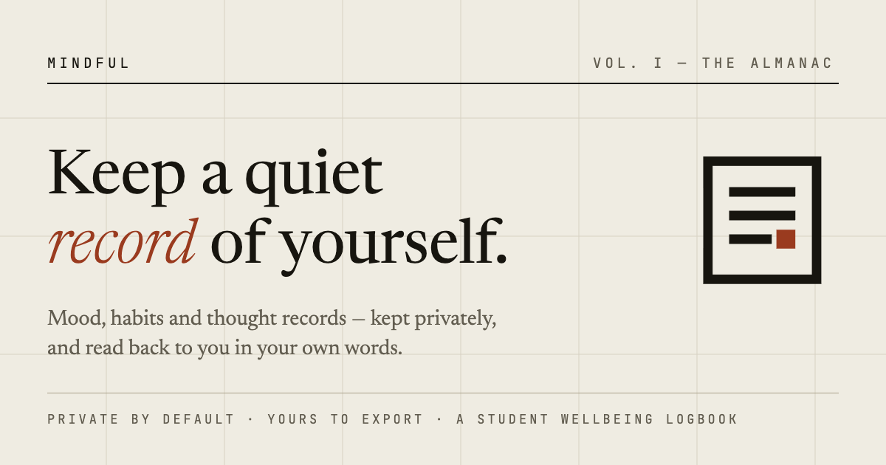
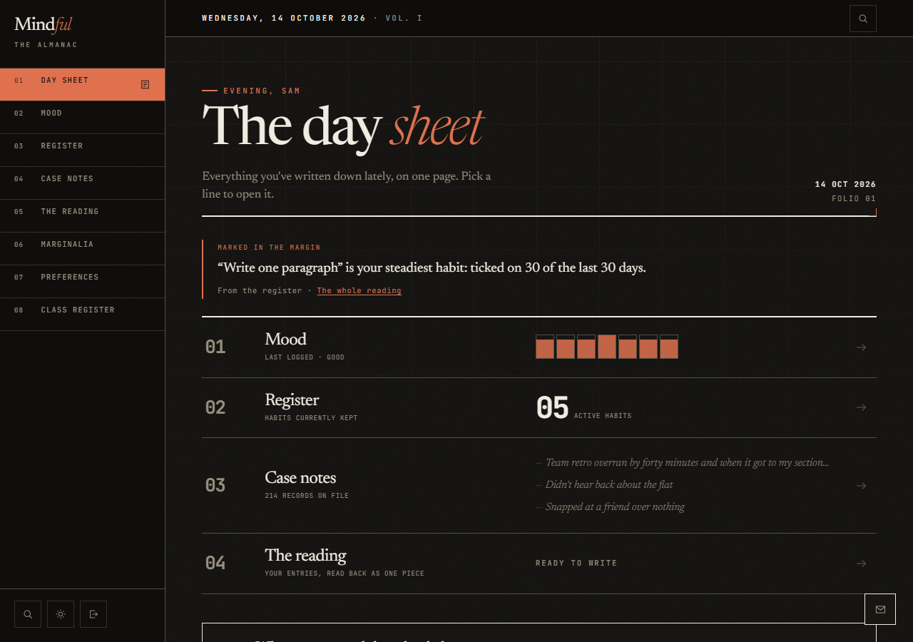
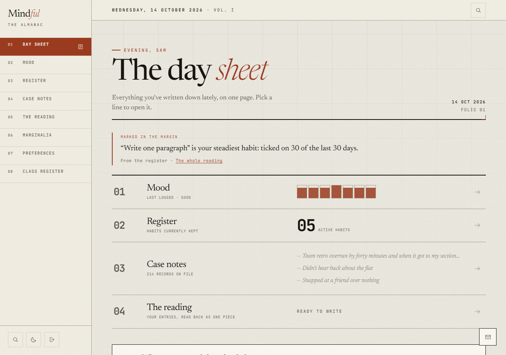
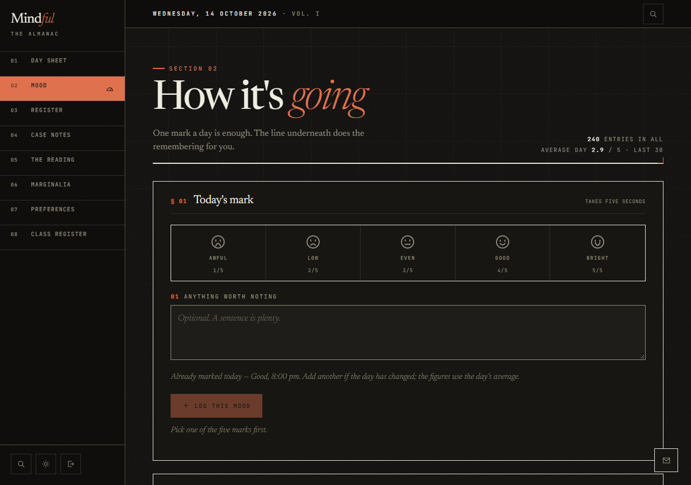
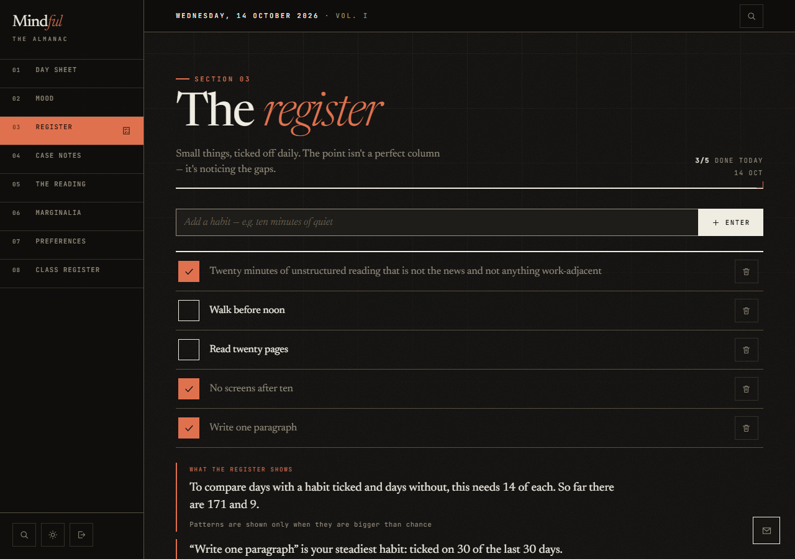
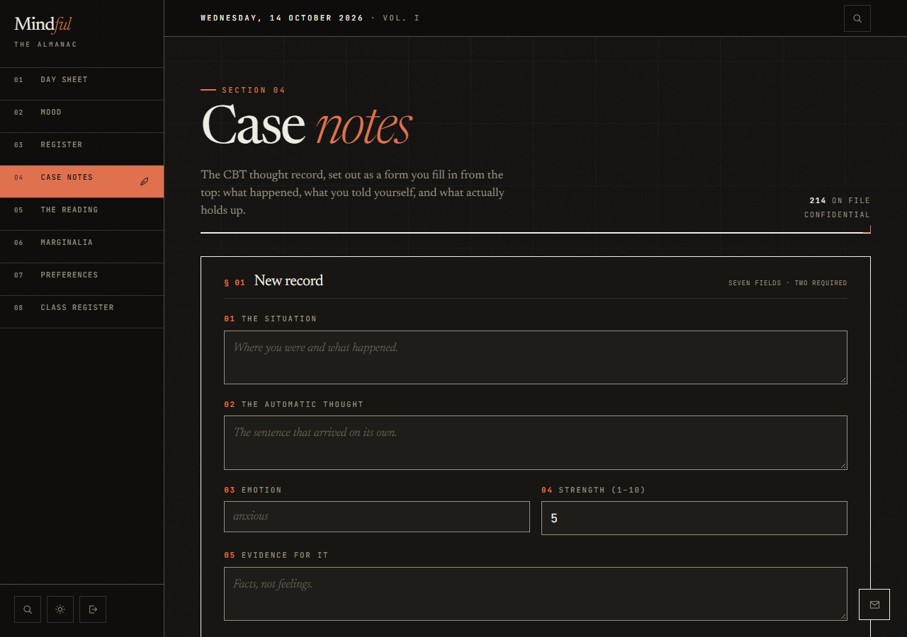
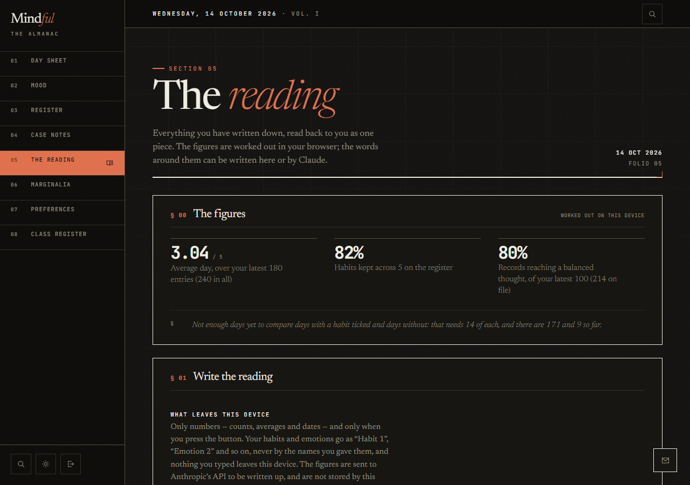

<p align="center">
  
</p>

<h1 align="center">Mindful</h1>

<p align="center">
  <strong>A private wellbeing journal for students: track your mood, keep small habits, and work through difficult thoughts.</strong>
</p>

<p align="center">
  <a href="https://website-1wf9.vercel.app">Live app</a> ·
  <a href="#features">Features</a> ·
  <a href="#privacy-first">Privacy</a> ·
  <a href="#run-it-locally">Run it locally</a>
</p>

---

## What it is

Mindful is a journal for students, many of them under 18. It has three tools and one page that ties them together:

- **Mood**: one mark a day, from awful to bright, with an optional note.
- **Habits**: small things ticked off daily. There are no streaks, because a missed day shouldn't feel like a failure.
- **Case notes**: CBT thought records. You write what happened, the thought that arrived, the evidence for and against it, and a more balanced view.
- **The reading**: everything you've written, read back to you as one piece, with plain figures and an optional written summary.

The app looks like an almanac or a field journal rather than a typical health dashboard. It is meant to feel calm and slow, not like a score to beat.

## Why I built it

Students write a lot of private things down when they're stressed, and most apps built for that either treat them as data to harvest or push streaks and scores at them. I wanted a journal that treats what a student writes as theirs. Privacy and consent are part of the product, not a settings page.

## Screenshots

These use built-in demo data, not anyone's real entries.

| | |
|---|---|
|  |  |
| **The day sheet**: the whole book on one page. Dark and light themes. | |
|  |  |
| **Mood**: one mark a day, with a note if you want one. | **The register**: small habits, ticked off daily. |
|  |  |
| **Case notes**: a guided CBT thought record. | **The reading**: your entries read back as one piece. |

## Features

- Daily mood log with a short note, and a weekday pattern shown only when it is bigger than chance
- Habit register with a calendar and a plain-list view
- Seven-field CBT thought record, paged 20 at a time
- A reading page: figures worked out in the browser, plus an optional written summary
- Light and dark themes, a density setting, and reduced-motion support
- Phone-friendly layout with 44px touch targets
- Classes for teachers and an admin directory, both limited by what each student has agreed to share
- A support line (Tele-MANAS 14416, Child Helpline 1098, Emergency 112) on every page

## Privacy first

- **Access is enforced in the database.** Row-level security and `SECURITY DEFINER` functions decide who can read what. The interface only decides what to offer.
- **Teachers see only what a student agrees to share.** A teacher or administrator needs the student's `share_with_teachers` consent, and even then sees no habit names and no times of day.
- **Nothing a student typed goes to the AI.** The optional written reading sends only counts, averages and dates. Habit names and emotion words go as "Habit 1" or "Emotion 2", and the browser puts the real words back. The server refuses any other text.
- **AI use is limited and fails safely.** There are three readings per student per day, each needs a confirmed account at least a day old, and if the AI is unavailable the page writes the same reading locally.
- **No streaks, no guilt.** A test in the repo keeps streak counters out of the app.
- **A privacy page that matches the database.** `/privacy` lists the files each statement was checked against, and a test keeps those files real.

## Built with

| Area | Tools |
|---|---|
| Front end | React 19, Vite, plain JavaScript and CSS, [motion](https://motion.dev) |
| Back end | Supabase (auth, Postgres, row-level security), Vercel serverless functions |
| Written readings | Claude through the Anthropic API, called from `api/report.js` |
| Quality | Boundary and deploy-config checks, a lint ratchet, Node tests, and pgTAP database tests |

The code is split into layers (`app`, `frontend`, `design`, `backend`, `shared`, `config`), and `scripts/check-boundaries.mjs` enforces which layer may import which. The full rules are in [`AGENT_RULES.md`](AGENT_RULES.md), and the access model is in [`supabase/SECURITY.md`](supabase/SECURITY.md).

## Run it locally

You need Node.js. The demo-data mode needs no Supabase account and makes no network calls to a database.

```bash
npm install
```

Then start it with demo data (`empty`, `week` or `heavy`):

```powershell
$env:VITE_USE_FIXTURES = "true"; $env:VITE_FIXTURE_SCENARIO = "heavy"; npm run dev
```

On macOS or Linux:

```bash
VITE_USE_FIXTURES=true VITE_FIXTURE_SCENARIO=heavy npm run dev
```

Plain `npm run dev` with no fixtures reads `.env.local` and talks to whatever Supabase project that file points to, so don't do that with a production key.

Run every check with one command:

```bash
npm run verify
```

## Project status

Mindful is a live project and still changing. Current working notes are in [`SESSION_NOTES.md`](SESSION_NOTES.md).

## Made by

**TetherVoid** designed and built Mindful.

If you are struggling, Mindful is not a replacement for help. In India you can call Tele-MANAS on **14416**, Child Helpline on **1098**, or Emergency on **112**.
